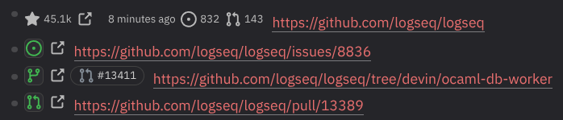

# Git Forge Watcher 

A [Logseq](https://logseq.com) plugin that watches GitHub repos, branches, issues and pull requests, rendering their live status inline inside your blocks.

Run its slash command on a block that contains a GitHub link and it drops a small widget between the bullet and the block's text: a status icon coloured by the current state, plus a link out to GitHub. Click the icon to force a refresh.



## What it does

The **Git Forge Watcher** slash command reads the GitHub link out of the block, prepends a renderer macro, and draws an inline widget at the start of the block (or the end, if you flip that widget kind's "insert at start" setting off). The widget is chosen from the shape of the link:

| Link | Widget |
| --- | --- |
| `github.com/<owner>/<repo>/pull/<number>` | [Pull request](#pull-request) |
| `github.com/<owner>/<repo>/issues/<number>` | [Issue](#issue) |
| `github.com/<owner>/<repo>/tree/<branch>` | [Branch](#branch) |
| any other `github.com/<owner>/<repo>…` link | [Repo](#repo) |

To get the repo widget for a deeper link (e.g. repo stats for a block that only links a pull request), use **Git Forge Watcher - Repo** instead: it resolves any GitHub link to its repository root.

### Repo

For a `github.com/<owner>/<repo>` link (or any deeper link, via **Git Forge Watcher - Repo**), it renders a card with:

- ⭐ **star count**, compacted the way GitHub does (`1.2k`, `12.3k`, `2.1m`)
- a link out to the repository
- the **last commit's** relative age, linking to the default branch's commit history
- **open issue** and **open pull request** counts, each linking to the matching tab

### Branch

For a block containing a `github.com/<owner>/<repo>/tree/<branch>` link, e.g.

```
[`logseq/upgrade-tailwind-base-ui`](https://github.com/logseq/logseq/tree/logseq/upgrade-tailwind-base-ui)
```

it renders:

- **A branch button** (GitHub's branch octicon), coloured by status:
  - 🟢 **green** — active (the branch exists and was committed to recently)
  - 🟡 **yellow** — stale (last commit older than the stale threshold)
  - 🔴 **red** — deleted (the branch no longer exists on GitHub)
- **Pull-request pills** for every PR opened from that branch, each showing the PR number and an icon coloured by state:
  - 🟢 green — open · ⚪ grey — draft · 🔴 red — closed · 🟣 purple — merged

### Issue

For a block containing a `github.com/<owner>/<repo>/issues/<number>` link (any trailing `#issuecomment-…` anchor is ignored), it renders an **issue button** coloured by state, plus a link out to the issue:

- 🟢 **green** — open
- 🟣 **purple** — closed as completed
- ⚪ **grey** — closed as not planned

### Pull request

For a block containing a `github.com/<owner>/<repo>/pull/<number>` link, it renders a **pull-request button** coloured by state, plus a link out to the PR:

- 🟢 **green** — open
- ⚪ **grey** — draft
- 🔴 **red** — closed
- 🟣 **purple** — merged

Status is read live from the GitHub REST API. Every widget's status icon (or, for the repo widget, its star button) is also a button: click it to force an immediate refresh, bypassing the cache.

## Usage

1. Put your cursor in a block that contains a GitHub link.
2. Type `/` and choose **Git Forge Watcher** (or **Git Forge Watcher - Repo** for the repo widget).

The command prepends a `{{renderer :gfw, <encoded-url>}}` macro to the block, which renders the widget inline. If the block has several GitHub links, run the command again to add a widget for the next one. Works on both DB graphs (reads `block/title`) and legacy file graphs (reads `block/content`).

You can also force the widget kind by hand with a third argument — `repo`, `branch`, `issue` or `pr` — e.g. `{{renderer :gfw, <encoded-url>, repo}}`.

Blocks created by older versions use the `:gfw-repo`, `:gfw-branch`, `:gfw-issue` and `:gfw-pr` macros. These keep working unchanged, always rendering as their named kind.

## Caching & offline behaviour

Status is cached in the plugin's `localStorage`, so it persists across restarts and is shared across graphs (GitHub status is global, not graph-specific). Multiple blocks referencing the same repo/branch/issue/PR coalesce into a single API request.

- Within the cache TTL (default **24 hours**), widgets render instantly from cache with no network call.
- Once the TTL expires, the next render re-queries GitHub.
- If that refresh fails — you're offline, rate-limited, or GitHub errors — the widget falls back to the **last known state**, shown dimmed with an "Offline — showing last known state" tooltip, rather than an error.
- Clicking a status icon always forces an immediate refresh.

## Settings

| Setting | Default | Description |
| --- | --- | --- |
| **GitHub token** | _(empty)_ | Optional personal access token. Raises the API rate limit and allows reading repos/branches/issues/PRs in private repos. |
| **Stale threshold (days)** | `30` | A branch whose last commit is older than this many days shows yellow (stale) instead of green (active). |
| **Prefer last URL** | `false` | When a block contains more than one matching GitHub link, slash commands use the first one by default; enable this to use the last one instead. |
| **Cache TTL (hours)** | `24` | How long repo/branch/issue/PR status is cached before re-querying GitHub. Click a status icon to force an immediate refresh. |
| **Repo widget at start of block** | `true` | When a slash command adds a repo widget, insert it at the start of the block. Turn off to append it at the end instead. |
| **Branch widget at start of block** | `true` | When the slash command adds a branch widget, insert it at the start of the block. Turn off to append it at the end instead. |
| **Issue widget at start of block** | `true` | When the slash command adds an issue widget, insert it at the start of the block. Turn off to append it at the end instead. |
| **Pull request widget at start of block** | `true` | When the slash command adds a pull request widget, insert it at the start of the block. Turn off to append it at the end instead. |

Without a token the plugin uses GitHub's unauthenticated rate limit (60 requests/hour per IP), which is fine for light use but may throttle on large graphs.

## Install

### From source (developer mode)

```sh
bun install
bun run build
```

In Logseq, enable **Developer mode** (Settings → Advanced), then **Load unpacked plugin** and point it at this project root.

### Develop with hot reload

```sh
bun install
bun run dev
```

`bun run dev` generates a `./dev/` directory (via `scripts/scaffold-dev.mjs`) and starts Vite from inside it. In Logseq, **Load unpacked plugin** and point it at **`./dev/`** (once). Thanks to [`vite-plugin-logseq`](https://github.com/pengx17/vite-plugin-logseq), edits to `src/` hot-reload inside Logseq without reloading the unpacked plugin.

`./dev/` runs under a distinct `logseq-plugin-git-forge-watcher-dev` plugin id with a `(Dev)` title, so it coexists with the marketplace release (Logseq refuses to load two plugins sharing an id). It symlinks `src/` and `index.html` back to the project root, so you keep editing the real sources; `./dev/` itself is git-ignored and regenerated on every `bun run dev`. Because the dev server only writes into `./dev/dist/`, the root `dist/` stays a real build.

Disable the `(Dev)` plugin in Logseq when the dev server isn't running, otherwise it will stall Logseq's startup waiting for `localhost:5173`.

| Command | `./dev/` contains | Use it for |
| --- | --- | --- |
| `bun run dev` | Vite dev server + symlinked `src/` | Day-to-day work — **HMR**, edits reflect live, no reload |
| `bun run build:dev` | the real `bun run build` output (symlinked `dist/`) | Testing the actual production bundle next to the marketplace release |

After a `build:dev` change, re-run it and reload via **Settings → Plugins → ⋯ → Reload** (the static build has no HMR).

## Project layout

```
src/
  index.ts         # plugin entry: registers the slash commands + macro renderer
  slash.ts         # the "Git Forge Watcher" and "Git Forge Watcher - Repo" slash commands
  render.ts        # `:gfw` (+ legacy `:gfw-*`) macro dispatch to the per-kind widgets
  render-repo.ts   # builds the inline repo widget (stars, last commit, issue/PR counts)
  render-branch.ts # builds the inline branch widget (status + PR pills)
  render-issue.ts  # builds the inline issue widget
  render-pr.ts     # builds the inline pull-request widget
  github.ts        # GitHub REST client: repo facts, branch status, PRs, issue/PR state
  parse-link.ts    # classifies a GitHub link as a repo/branch/issue/PR widget
  parse-repo.ts    # extracts owner/repo from any GitHub link
  parse-branch.ts  # extracts owner/repo/branch from a tree link
  parse-issue.ts   # extracts owner/repo/number from an issues link
  parse-pr.ts      # extracts owner/repo/number from a pull link
  cache.ts         # localStorage TTL cache + in-flight request dedupe
  icons.ts         # GitHub octicon SVGs (branch / PR / issue states)
  settings.ts      # plugin settings schema (token, stale threshold, cache TTL, per-command placement)
  handle-popup.ts  # Esc / click-outside dismiss helpers
scripts/
  scaffold-dev.mjs    # generates ./dev/ (-dev id, symlinked src/) for `bun run dev`
  make-dev-plugin.mjs # generates ./dev/ (-dev id, symlinked dist/) for `bun run build:dev`
index.html         # Vite entry consumed by Logseq
vite.config.ts     # registers vite-plugin-logseq
biome.json         # formatter + linter config
```

## License

MIT
